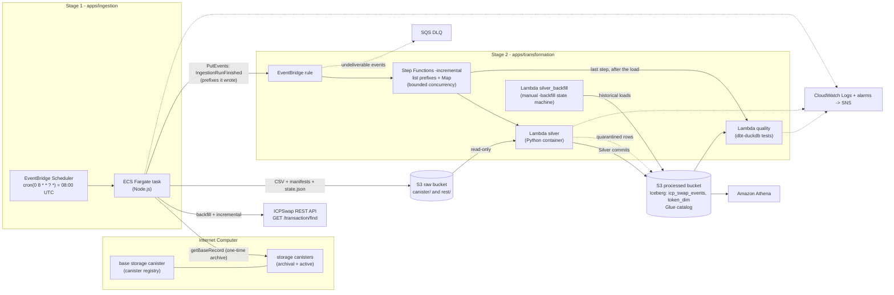

# icp-swap-elt

[](https://github.com/RurociagDanych/icp-swap-elt/actions/workflows/ci.yml)

Batch ELT pipeline that loads [ICPSwap](https://app.icpswap.com) swap transactions from the Internet Computer into deduplicated Apache Iceberg tables queryable from Amazon Athena.

It pulls swap transactions from ICPSwap storage canisters and the ICPSwap REST API into an immutable raw CSV layer on S3, then normalizes them into a deduplicated `icp_swap_events` Apache Iceberg fact table and a `token_dim` dimension. Data-quality tests run after every load.

## Status

Active. Last substantive change: 2026-11-04. Both stages are implemented and deployed from this repo; CI covers tests and Terraform checks.

## Architecture



Two independently deployable stages (`apps/ingestion`, TypeScript on Fargate; `apps/transformation`, Python on Lambda + Step Functions), wired by an `IngestionRunFinished` EventBridge event instead of Terraform references. Components, design decisions and limits: [docs/ARCHITECTURE.md](docs/ARCHITECTURE.md).

### Repository layout

```
```
apps/
  ingestion/         TypeScript job: canister + REST ingestion to S3 (src/, tests/, scripts/, Dockerfile)
  transformation/    Python Lambdas: Silver load, compaction, quality (src/, test/, Dockerfile)
infra/
  ingestion/{storage,compute}/        raw S3 bucket | ECR, ECS/Fargate, IAM, scheduler, alerting
  transformation/{storage,compute}/   Iceberg/Athena/Glue | Lambda x3, Step Functions, IAM, DLQ, alarms, budget
docs/
  ARCHITECTURE.md    stages, components, design decisions, limits
  OPERATIONS.md      run modes, CLI, S3 layout, reliability, runbook (deploy, verify, day-2, teardown)
  SECURITY.md        IAM, delete protection, networking
.github/workflows/ci.yml   Node build/tests, Python suite, terraform fmt/validate/test
AGENTS.md            contributor guidelines
```
```

## Quick start

```bash
# ingestion (Node.js 22), local output under ./out/
cd apps/ingestion
npm install
npm run dev -- --mode sync        # modes: sync, canister, backfill, incremental
npm test

# transformation (Python 3.12, offline: SQLite-backed Iceberg catalog, no AWS)
cd apps/transformation
make venv PYTHON=python3.12
make test-python
```

Ingestion details: [apps/ingestion/README.md](apps/ingestion/README.md). Transformation details: [apps/transformation/README.md](apps/transformation/README.md).

## Configuration

There is no `.env.example`. The ingestion job reads its settings from CLI flags; these environment variables provide defaults (full flag table in [docs/OPERATIONS.md](docs/OPERATIONS.md#cli-ingestion)):

| Variable | Used by | Purpose |
| --- | --- | --- |
| `S3_BUCKET` | ingestion (`--s3-bucket`) | Target raw bucket; omit for local output under `./out/` |
| `S3_PREFIX` | ingestion (`--s3-prefix`) | Key prefix in the bucket (default `icp-swap-elt`) |
| `EVENT_BUS_NAME` | ingestion (`--event-bus`) | EventBridge bus that receives `IngestionRunFinished`; omit for no event |
| `REST_TIMEOUT_MS` | ingestion REST client | Optional REST request timeout override |
| `RETRY_ATTEMPTS`, `RETRY_BASE_DELAY_MS`, `RETRY_MAX_DELAY_MS` | ingestion retry helper | Optional backoff overrides |

AWS deployment settings live in each Terraform root's `terraform.tfvars.example` and `backend.hcl.example` under `infra/`. The transformation Lambdas get their environment from `infra/transformation/compute`; limits and their variables are in [apps/transformation/README.md](apps/transformation/README.md).

## Testing

```bash
# ingestion
cd apps/ingestion
npm ci
npm test
npm run build

# transformation (offline, no AWS calls)
cd apps/transformation
make venv PYTHON=python3.12
make test-python

# Terraform, for each root under infra/ (offline, mock provider)
terraform -chdir=infra/ingestion/storage fmt -check -recursive
terraform -chdir=infra/ingestion/storage init -backend=false -input=false
terraform -chdir=infra/ingestion/storage validate
terraform -chdir=infra/ingestion/storage test
```

CI (`.github/workflows/ci.yml`) runs all of these, for all four Terraform roots, on every push and pull request.

## Deployment

AWS (ECS Fargate, Lambda, Step Functions, S3, Glue, Athena) with four Terraform roots under `infra/`. Apply each stage's storage root before its compute root. Deployment, verification and teardown: [docs/OPERATIONS.md](docs/OPERATIONS.md#runbook).

## Docs index

- [docs/ARCHITECTURE.md](docs/ARCHITECTURE.md): stages, components, key design decisions, scale and limits.
- [docs/OPERATIONS.md](docs/OPERATIONS.md): run modes, CLI, S3 layout, reliability and the runbook (deploy, verify, day-2 operations, teardown, stage wiring).
- [docs/SECURITY.md](docs/SECURITY.md): IAM scoping, networking, state and delete protection.
- [docs/RUNBOOK.md](docs/RUNBOOK.md): pointer to the runbook, now in OPERATIONS.md.

## License

MIT, see [LICENSE](LICENSE).
