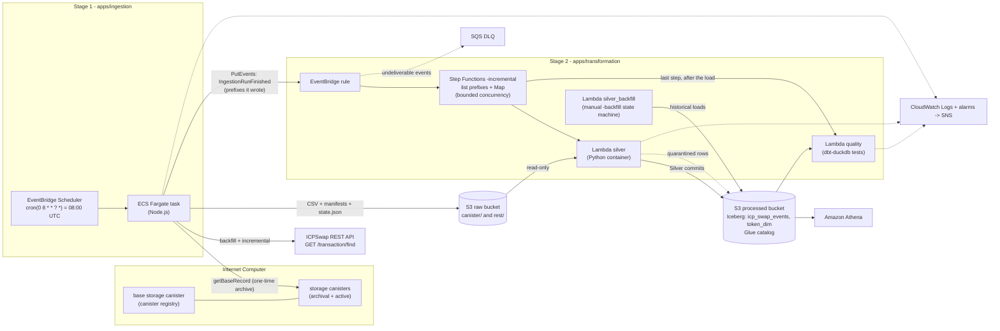

# icp-swap-elt

[](https://github.com/RurociagDanych/icp-swap-elt/actions/workflows/ci.yml)

An end-to-end data pipeline for [ICPSwap](https://app.icpswap.com) (a decentralized exchange on the Internet Computer), kept as a single monorepo of two independently deployable stages, each with its own Terraform roots under `infra/`:

- **`apps/ingestion/`** (TypeScript) — pulls swap transactions from ICPSwap storage canisters and the ICPSwap REST API and lands them as raw, immutable CSV files in Amazon S3. Runs as a containerized job on AWS Fargate, scheduled with EventBridge.
- **`apps/transformation/`** (Python) — normalizes the raw feeds into a deduplicated `icp_swap_events` Apache Iceberg fact table plus a `token_dim` dimension, queryable from Amazon Athena. Runs as container-image AWS Lambda functions orchestrated by Step Functions and started by the ingestion run's completion event. See [`apps/transformation/README.md`](apps/transformation/README.md).

Data lands raw and immutable per ingestion run; transformation reads that raw data and never mutates it. The only coupling between the stages is the raw bucket name and prefix, passed to the transformation Terraform as plain variables.

## Architecture



Stage 1 (ingestion) ends at the raw S3 bucket; stage 2 (transformation) starts there. The two stages are deployed and destroyed independently and are wired by an event, not by Terraform references: when an ingestion run finishes it publishes `IngestionRunFinished` (bucket, run id, status and the S3 prefixes it wrote) to EventBridge, and a rule in the transformation stack starts the `-incremental` load state machine on exactly those prefixes. The same path serves the one-time canister archive, the REST backfill and the scheduled incremental runs, scheduled or started by hand.

### Stage 1 — ingestion

Since 2026-06-07 the ICPSwap storage canisters stopped receiving new transactions through the `getBaseRecord` path, so ongoing ingestion moved to the ICPSwap REST API (`GET /transaction/find`). The canister path is retained as a one-time deep-history archive because the REST API does not expose the full history.

Run modes:

- **`canister` mode** (alias `full`) reads every storage canister (oldest → newest, bounded concurrency) and writes one CSV per canister. Run **once** to archive deep history; on completion it records `canisterArchiveComplete` and the canister↔REST seam (`canisterMaxTxTime`) in `state.json`.
- **`backfill` mode** walks the REST API newest→oldest down to the canister seam minus a configurable overlap, with a fixed `end` snapshot for stable pagination and a resumable page cursor.
- **`incremental` mode** fetches new REST transactions since the stored `txTime` watermark, with overlap + `txHash` deduplication.
- **`sync` mode** (default, scheduled) runs `backfill` if it has not completed, then `incremental`. It never runs the canister archive.

**Cutover:** run `--mode canister` once to capture pre-API history; the scheduled `sync` then keeps the dataset current from the REST API and never re-touches the canisters. Canister and REST records have different schemas and land **raw and separate** in S3 (the transformation stage reconciles the overlap band).

### Stage 2 — transformation

- **Two transformation Lambdas over one image.** `silver` (2048 MB / 300 s) runs the `-incremental` state machine started by each ingestion event: it lists the announced prefixes once, fans out one `backfill_file` invocation per CSV with bounded concurrency, compacts, and also serves the ad-hoc `token_metadata` mode. `silver_backfill` (10240 MB / 900 s) runs the same definition as the manually started `-backfill` state machine for historical loads. `quality` is the last step of both state machines: it runs the dbt-duckdb data-quality tests on the freshly loaded tables, so one ingestion run drives the whole flow ingestion -> load -> quality. An error-severity finding fails the execution and raises the alarm. Iceberg compaction, snapshot expiry and orphan-file cleanup run in our own job (`mode=compact`, the `CompactTable` step); the Glue table optimizers are off by default (`enable_table_optimizers`).
- **Silver fact table.** One row per deduplicated `event_id`; the Iceberg table itself is the only dedup state (no side index). Conflicting payloads resolve deterministically and are flagged `quality_status = 'conflict'`; rows that fail validation are quarantined, not fatal. Partitioning is `year(event_timestamp)`.
- **`token_dim`.** Current symbol/name/standard/decimals per ledger, "latest observation wins" under one `as_of` column.
- **Seam reconciliation.** A fixed, one-time content-based dedup for the ~6.25 h window where the canister archive and the REST backfill cover the same swaps under different hashes.
- **Event-driven load.** Each ingestion run announces what it wrote (`IngestionRunFinished`, also after a failed run, for the files it had already committed), so full loads, backfills, incremental runs and manual runs all take the same path. Loading is idempotent (`event_id` dedup), so a re-delivered or re-started event changes nothing.

Details, operating limits and the dedup/commit model: [`apps/transformation/README.md`](apps/transformation/README.md).

## Key design points (ingestion)

- **Streaming sinks** — rows are streamed to S3 via multipart upload (or to a local file) without buffering whole datasets in memory; every sink tracks row count, byte count, and a SHA-256 checksum as it writes.
- **Run manifest** — every run writes a `manifest_<mode>.json` with per-file rows/bytes/sha256, enabling downstream completeness checks. A `sync` run writes both `manifest_backfill.json` and `manifest_incremental.json`; its backfill files land in the same `rest/incremental/<runId>/` folder as the incremental file.
- **Resume state** — per-canister progress (`lastTotal`, recent transaction hashes, `completed` flag) is persisted to `state.json` (S3 or local), so interrupted full loads resume and incremental runs never re-emit known rows.
- **Bounded retries** — all canister queries and S3 state writes use exponential backoff (max 5 attempts).
- **Guarded inputs** — `--page-size` (1..1000), `--concurrency` (1..20), and `--overlap` (>= 0) are validated before anything runs.
- **Least-privilege infra** — the Fargate task role can list the bucket only within its configured S3 prefix, read, write and abort multipart uploads for objects under that prefix, and **delete only its run lock** (`<prefix>/locks/*`). A bucket-policy Deny on `s3:DeleteObject*` below `<prefix>/canister/` and `<prefix>/rest/` protects the ingested history against deletion by anyone except the principals listed in `delete_exempt_principal_arns`. The bucket is private, versioned, encrypted, ACL-free (`BucketOwnerEnforced`) and TLS-only.

## Reliability & operations (ingestion)

- **Structured logs** — every event is a JSON line (`ts`, `level`, `msg`, `runId`, `mode`, plus context), queryable directly in CloudWatch Logs Insights.
- **Run lock** — a lock object (`<prefix>/locks/run.lock`) is created with an S3 conditional write (`If-None-Match: *`) before any work; a second concurrent run (manual + scheduled overlap) logs a warning and exits cleanly. Locks left behind by killed runs are stolen after a 6-hour TTL.
- **Failure alerting** — an EventBridge rule fires on any task in the cluster stopping with a non-zero exit code (or failing to start) and publishes to an SNS topic; set `alert_email` in `infra/ingestion/compute` to subscribe.
- **Lifecycle hygiene** — the raw bucket aborts incomplete multipart uploads after 7 days and expires noncurrent object versions after a configurable window (default 30 days), so versioning doesn't grow storage forever.
- **Run announcement** — every S3 run ends by publishing `IngestionRunFinished` (bucket, run id, status and the S3 prefixes it wrote) to EventBridge; the transformation stage loads exactly those prefixes. A run that wrote nothing publishes nothing; a failed publish after a successful run fails the task.
- **Anomaly visibility** — a shrinking source canister total (possible reset/migration) is logged as a warning instead of being silently treated as "no new data".

## CLI (ingestion)

| Flag | Default | Description |
| --- | --- | --- |
| `--mode` | `sync` | `sync`, `canister` (alias `full`), `backfill`, or `incremental` |
| `--host` | `https://ic0.app` | Internet Computer host, canister mode |
| `--base-storage` | `g54jq-hiaaa-aaaag-qck5q-cai` | base storage canister (registry), canister mode |
| `--page-size` | `1000` | records per canister query (1..1000), canister mode |
| `--concurrency` | `5` | parallel canisters in canister mode (1..20) |
| `--overlap` | `50` | canister-mode re-fetch window |
| `--rest-base-url` | `https://api.icpswap.com/info` | REST API base URL |
| `--rest-page-size` | `100` | REST records per page (1..100; API caps at 100) |
| `--backfill-overlap-ms` | `3600000` | overlap below the canister seam, in ms |
| `--incremental-overlap-ms` | `300000` | REST incremental re-fetch window, in ms |
| `--backfill-floor` | — | explicit floor (epoch ms) when `canisterMaxTxTime` is absent |
| `--backfill-pages-per-file` | `50` | REST pages per committed backfill file (≥1) |
| `--action-types` | `Swap,AddLiquidity,DecreaseLiquidity,Claim` | REST `actionTypes` filter |
| `--s3-bucket` | env `S3_BUCKET` | target bucket; omit for local output |
| `--s3-prefix` | env `S3_PREFIX` or `icp-swap-elt` | key prefix in the bucket |
| `--event-bus` | env `EVENT_BUS_NAME` | EventBridge bus that receives `IngestionRunFinished` at the end of an S3 run; omit for no event |
| `--out-dir` | `./out` | local output directory (local mode) |
| `--log-file` | `./out/ingestion.log` | local log file (local mode) |
| `--help` | — | print usage and exit; unknown flags are rejected |
| `--state-file` | `./out/state.json` | local state path (local mode) |

S3 layout (source-separated):

```
s3://<bucket>/<prefix>/canister/<runId>/<nnnn>_<canisterId>.csv
s3://<bucket>/<prefix>/rest/backfill/<runId>/transactions_backfill_<endSnapshot>_p<NNNNNN>.csv
s3://<bucket>/<prefix>/rest/incremental/<runId>/transactions_incremental_<runId>.csv
s3://<bucket>/<prefix>/<segment>/<runId>/manifest_<mode>.json
s3://<bucket>/<prefix>/state/state.json
```

## Run locally

Ingestion (Node.js 22):

```bash
cd apps/ingestion
npm install
npm run dev -- --mode canister --page-size 1000 --concurrency 5   # one-time deep-history archive
npm run dev -- --mode backfill                                     # REST history down to the seam
npm run dev -- --mode incremental                                  # new REST transactions
npm run dev -- --mode sync                                         # backfill-if-needed then incremental
npm test
```

Local runs write CSVs, `state.json`, a manifest, and a log under `./out/`.

Transformation (Python 3.12, fully offline - SQLite-backed Iceberg catalog, no AWS calls):

```bash
cd apps/transformation
make venv PYTHON=python3.12
make test-python
```

## Deploy to AWS

> Step-by-step instructions — including verification, day-2 operations, and teardown — live in the **[runbook](docs/RUNBOOK.md)**.

Each stage has its own pair of Terraform roots under `infra/`, so compute can be destroyed without touching collected data:

| Stage | Storage root (persistent data) | Compute root |
| --- | --- | --- |
| ingestion | `infra/ingestion/storage` — raw-data S3 bucket (versioning, SSE, public-access block, owner-enforced ownership, TLS-only and delete-protection policy) | `infra/ingestion/compute` — ECR (immutable tags), ECS cluster + Fargate task definition, CloudWatch log group, least-privilege IAM, EventBridge schedule, failure and scheduler alerting |
| transformation | `infra/transformation/storage` — Iceberg warehouse/processed bucket, Athena results and access-logs buckets, Glue database, Athena workgroup | `infra/transformation/compute` — ECR (immutable tags), Lambda x3 (`silver`, `silver_backfill` and `quality` with its own read-only role), optional Glue table optimizers (off by default), Step Functions (S3 manifest + Distributed Map, logging), EventBridge rule, IAM, DLQ, CloudWatch alarms, SNS, budget |

The two stages are deployed independently; neither stage's Terraform references the other's resources except through a plain bucket-name / prefix input variable (`raw_bucket_name`, `raw_prefix`). State is remote: every root has a partial S3 backend (native locking, Terraform >= 1.10) configured from an untracked `backend.hcl` (`backend.hcl.example` per root, bootstrap in runbook section 3.0). Apply the storage root first, then the compute root:

```bash
# ingestion
cd infra/ingestion/storage
cp terraform.tfvars.example terraform.tfvars   # edit values
terraform init -backend-config=backend.hcl && terraform apply

cd ../compute                                   # set bucket_name from the storage output
cp terraform.tfvars.example terraform.tfvars   # edit values
terraform init -backend-config=backend.hcl && terraform apply
```

The transformation stack is triggered by the ingestion event (default bus, `event_bus_name`) and ends with the quality check; no schedule is needed on the transformation side. The only schedule of the whole pipeline is the ingestion one (`schedule_expression`, 08:00 UTC in the example file).

The ingestion compute root requires explicit `vpc_id` / `subnet_ids` (private by default: `assign_public_ip = false`, `use_default_vpc = false`; NAT or public subnets are needed for the Internet Computer and ICPSwap APIs, see runbook "Networking"). ECR repositories are immutable, so images are pushed under a unique tag that is passed as `image_tag`. The transformation roots are applied the same way; its image has to be pushed between two applies - see runbook section 6. Teardown of every root, including emptying the versioned buckets, is in the runbook.

Build, push, and trigger a one-off ingestion run with the helper (reads everything from Terraform outputs):

```bash
TAG=$(git rev-parse --short=12 HEAD)   # ECR tags are immutable: always a unique tag, then set image_tag and apply
apps/ingestion/scripts/aws_build_push_and_run.sh --build-only --tag "$TAG"
apps/ingestion/scripts/aws_build_push_and_run.sh --mode canister --tag "$TAG"   # one-time deep-history archive
apps/ingestion/scripts/aws_build_push_and_run.sh --mode sync --tag "$TAG"       # scheduled path: backfill-if-needed + REST incremental
```

Tear down compute while keeping all data:

```bash
cd infra/ingestion/compute && terraform destroy
```

## Project layout

```
apps/
  ingestion/                     Node.js app (own package.json, tsconfig, Dockerfile)
    src/index.ts                 entrypoint: mode dispatch + canister archive (runFull)
    src/lib/config.ts            CLI parsing + validation
    src/lib/csv.ts               canister swap transaction -> CSV row mapping
    src/lib/csvSink.ts           schema-driven streaming sinks (local file, S3 multipart) with checksums
    src/lib/restClient.ts        ICPSwap /transaction/find REST client (paged, retried)
    src/lib/restCsv.ts           REST record -> raw CSV row mapping
    src/lib/restPaging.ts        backfill/incremental paging + dedup helpers
    src/lib/restRuns.ts          runBackfill / runIncrementalRest / runSync orchestration
    src/lib/logger.ts            structured JSON-lines logger
    src/lib/retry.ts             bounded exponential-backoff retry
    src/lib/state.ts             resume-state schema (canister seam + REST cursor/watermark)
    src/lib/storageTarget.ts     StorageTarget interface: local | S3 (state, sinks, manifest, run lock)
    src/idl/                     Candid interfaces (canisters) + REST record type
    tests/                       node:test suites for the pure logic
    scripts/                     build/push/run helper for the Fargate task
  transformation/                Silver transformation Lambda (Python) - see its own README
    src/  test/  Dockerfile  Makefile
infra/
  ingestion/{storage,compute}/        raw-data S3 bucket | ECR, ECS/Fargate, IAM, CloudWatch, scheduler, alerting
  transformation/{storage,compute}/   Iceberg/Athena/Glue storage | Lambda x3, Step Functions, IAM, DLQ, alarms, budget
docs/RUNBOOK.md                  local runs, tests, AWS deployment of both stages, operations, teardown
.github/workflows/ci.yml         CI: ingestion build + tests, transformation tests, terraform fmt/validate/test
```

## License

[MIT](LICENSE)
